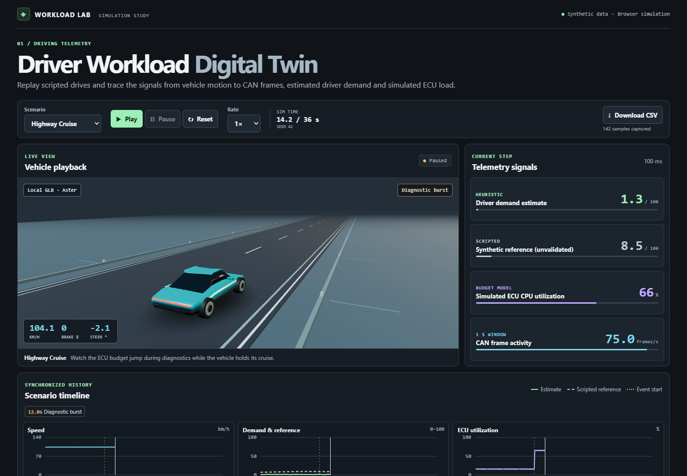

# Driver Workload Digital Twin

A browser-based driving simulation for exploring synthetic CAN telemetry, a heuristic estimate of driver demand, and a separate simulated ECU CPU budget.



## Run locally

Use Node.js 24 LTS and npm. From a checkout:

```sh
npm ci
npm run dev
npm test
npm run build
npm run preview
```

Open the project URL printed by Vite. The production project base is `/driver-workload-digital-twin/`.

## Three drives, one simulation clock

| Scenario | Duration | What to watch |
| --- | --- | --- |
| **Highway Cruise** | 36 s | From 12–17 s, diagnostic frames raise modeled ECU utilization from about 15–16% to 65–66%, while cruise and the driver estimate stay steady. |
| **Urban Stop-and-Go** | 40 s | Two stops and a right turn shift the braking and steering inputs. |
| **Sudden Hazard** | 34 s | A barricade appears at 12 s. Compare the elevation and recovery of the estimated and reference curves. |

Choose a scenario and play at 0.5×, 1× or 2×. Pause to inspect the newest CAN frames, filter by ID, and download the captured CSV. Reset or change scenario to start a new session. Each replay with the same scenario, schema version and seed produces the same samples and frame bytes across playback rates.

## How it fits together

- `src/sim/` implements scenario scripts, a fixed 100 ms clock, seeded signals, a shared CAN codec, the demand heuristic, ECU processing costs and CSV serialization in JavaScript independent of the DOM or renderer.
- `src/scene/` renders a local GLB with Three.js. A procedural vehicle handles model load failure. A static illustration handles unavailable WebGL.
- `src/ui/` and `src/main.js` present the session state as synchronized charts, current readings and a bounded frame inspector.
- `tests/` verifies replay determinism, clock behavior, CAN bytes and timing, signal limits, diagnostic independence and the CSV contract.

See the [telemetry contract](docs/telemetry.md) for formulas, units, CAN IDs and binary fields, and the CSV schema. See the [asset notes](docs/assets.md) for origins and regeneration. Original code and assets use the [MIT License](LICENSE).

## Interview walkthrough · 75 seconds

1. **0–25 s · Highway Cruise.** Press Play at 2× and pause just after 12 seconds. Point out the 0x7A0 frames and the ECU utilization jump, then compare the steady speed and low driver-demand estimate.
2. **25–55 s · Sudden Hazard.** Select the scenario and replay at 2×. When the barricade appears, point to the brake lights, the solid estimate and the dashed reference. Explain how the heuristic and scripted keyframes produce different magnitudes and recovery curves.
3. **55–75 s · Inspect and export.** Pause and open the frame inspector to explain one signed acceleration value. Download the CSV and point to the simulation timestamps, event IDs and distinct driver and ECU columns.

## Scope and limitations

“Digital twin” is the project name for a simulation prototype with no physical vehicle connection. All data and CAN identifiers are synthetic. The demand index is an illustrative heuristic with no machine learning, human measurement, safety rating or empirical validation. “Synthetic ground truth” refers to the scenario's unvalidated scripted reference. Its shared origin with the input script limits the comparison to the simulated scenarios. The ECU budget is a separate fictional model. The 3D track and obstacle illustrate the scenario rather than model road or vehicle dynamics.

This independent portfolio project has no affiliation with, endorsement from, or participation by Toyota or Woven by Toyota.
