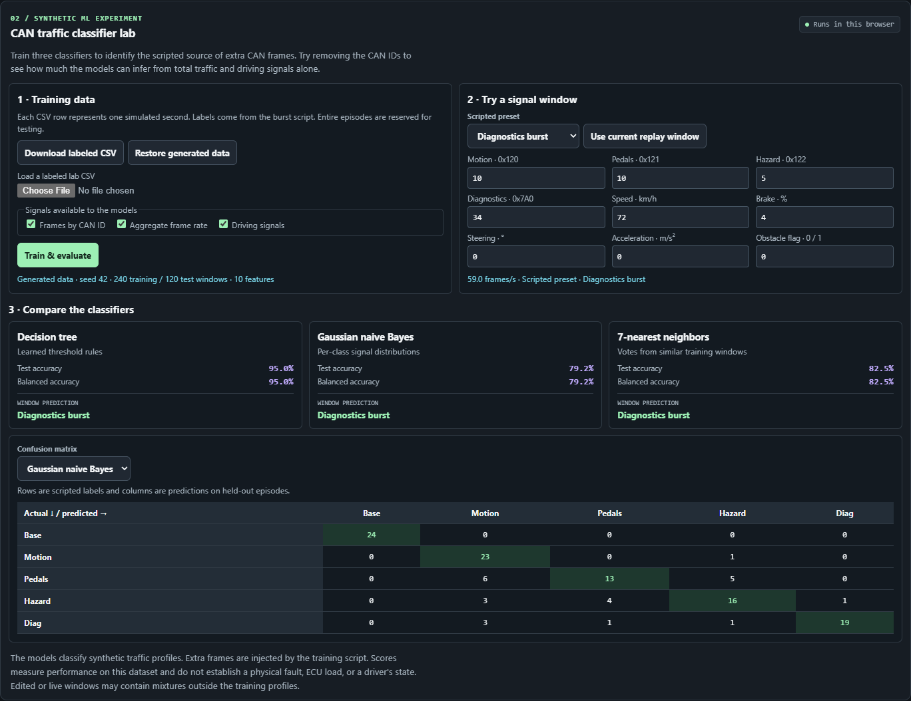

# CAN traffic classifier lab

The lab compares a depth-limited decision tree, Gaussian naive Bayes and 7-nearest neighbors. All three fit in the browser. Each model predicts the scripted source of extra CAN messages in one window. The five labels are routine cadence, vehicle motion burst, pedal message burst, hazard status burst and diagnostics burst. These are traffic profiles, so a hazard message burst can occur even when the obstacle flag is clear.

## Training data

Seed 42 generates 60 episodes, 12 per label. Each starts a seeded replay of Highway Cruise, Urban Stop-and-Go or Sudden Hazard with its ordinary CAN cadences. City Intersections is available as an unlabeled replay probe. The generator disables the built-in highway diagnostic burst while making the dataset, then injects integer counts into the one-second frame totals. A burst episode chooses a dominant message family and intensity, then varies the counts from window to window. Other message families can gain background frames. The routine class only gains small background counts. The burst script provides the label independently of the measured inputs. The lab varies frame counts without modeling individual added payloads, arbitration, timing jitter, physical utilization or packet loss.

Each episode supplies six consecutive one-second windows at a seeded offset. Eight episodes per class train the models (240 rows) and four per class form the held-out evaluation set (120 rows). A scenario and seed pair cannot appear in both splits. Driving signals are read at the end of each window. Feature scaling uses only training rows. Held-out accuracy is the fraction of correct predictions. Balanced accuracy averages recall equally across classes. The matrix shows actual rows and predicted columns. Results measure generalization within the simulator's data design.

## Try the models

1. Open the lab and choose a scripted preset. Edit any message rate or driving value to build a custom window.
2. Disable **Frames by CAN ID** and train again. Different sources can produce the same aggregate rate, so the model loses information about which ID changed.
3. Replay for at least one second and choose **Use current replay window**. This copies the previous simulated second of message counts and the current driving signals into an unlabeled probe. The model can guess a profile for this window. Mixed or unusual traffic may fall outside the training distribution.

The lab download contains the current labeled dataset. You can edit it or bring your own compatible synthetic dataset, then upload it to fit the same three models locally. The replay telemetry CSV remains a separate, unlabeled schema. Files stay in the browser.

## Labeled CSV format

Keep the exact header from the downloaded template, plain UTF-8, unquoted values, and a period for decimals. The lab accepts up to 2,400 windows and a 1 MB file. All five classes must appear in each split. Use an episode identifier and a unique scenario/seed pair for each independent run. Use the same split and label for all windows in an episode. Times are positive multiples of one second.

| Fields | Meaning |
| --- | --- |
| `episode_id`, `scenario_id`, `seed`, `sim_time_ms` | Episode identifier, scenario slug, unsigned 32-bit seed and window end in milliseconds. |
| `split` | `train` or `test`. |
| `scripted_source` | `baseline`, `motion`, `pedal`, `hazard` or `diagnostic`. |
| `motion_fps`, `pedal_fps`, `hazard_fps`, `diagnostic_fps` | Rates in frames/s for 0x120, 0x121, 0x122 and 0x7A0. |
| `total_fps` | Sum of the four per-ID rates. |
| `speed_kmh`, `brake_pct`, `steer_deg`, `long_accel_mps2`, `hazard_active` | Simulated end-of-window context. The obstacle flag is 0 or 1. |

Predictions explain which scripted profile best matches the inputs available to each model. They are separate from the simulated ECU time budget and from the scripted driver avatar cues. A real causal claim would require controlled interventions and independent observations.
