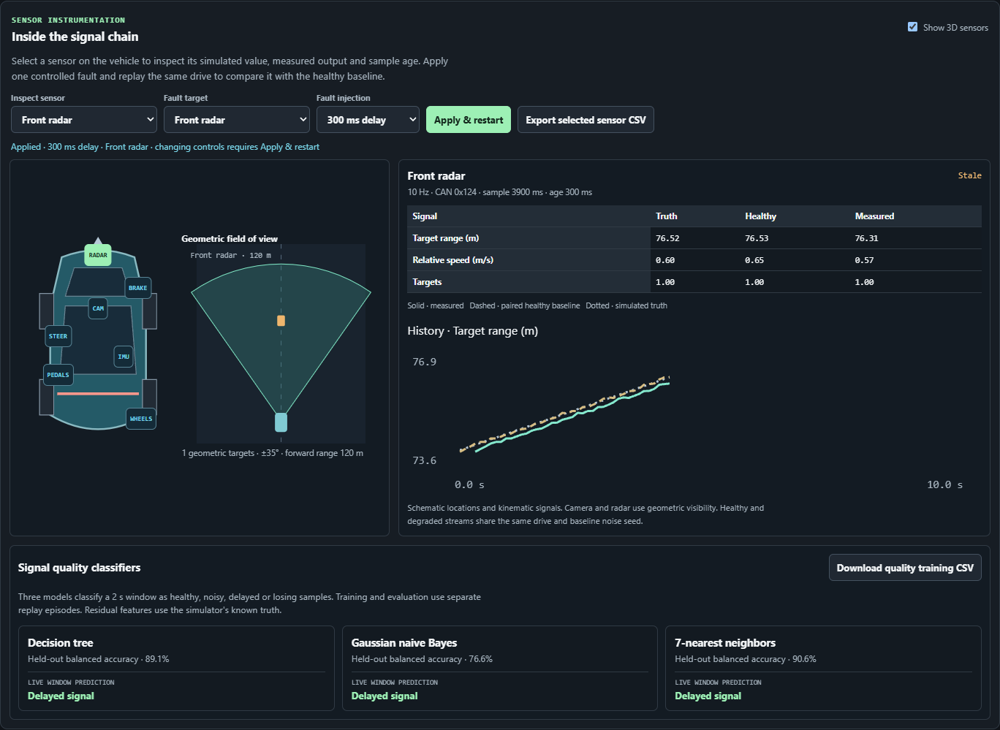

# Sensor instrumentation and controlled faults

The simulator offers seven synthetic sensor groups. Select a marker on the 3D car or the schematic map. Each sensor has a fixed sampling cadence and bounded values. All calculations run locally. The 3D dots show schematic mounting locations. Forward sectors show the configured geometric fields of view.

## Sensor definitions

| Group | Cadence | Values and model |
| --- | --- | --- |
| Wheel speeds | 10 Hz | Four speeds in km/h. Kinematic left/right differences use a 1.65 m track and yaw rate. |
| IMU | 10 Hz | Longitudinal acceleration from the speed integration, lateral acceleration from speed × yaw rate, and yaw rate in °/s. Positive yaw follows a right turn. |
| Steering | 10 Hz | Signed steering angle. Positive means right. |
| Pedals | 10 Hz | Accelerator and brake positions in %. |
| Brake pressure | 10 Hz | 0.8 × brake percentage, in bar. |
| Front radar | 10 Hz | Nearest target range, relative range rate and number of targets. Maximum range 120 m, half angle 35°. |
| Front camera | 5 Hz | Nearest target range and number of targets. Maximum range 80 m, half angle 40°. |

Yaw rate uses a bicycle approximation with a 2.65 m wheelbase and a 15:1 steering ratio. These illustrative parameters omit suspension, tire dynamics, slip and actuator control. Perception uses vehicle-relative object centers, angle and Euclidean distance. The camera is a geometric detector. The model omits image processing, material-dependent radar returns and occlusion. Relative range rate uses consecutive observations of the same nearest object. A change of object resets this rate to zero. An empty target set uses maximum range and zero target count.

## Paired signal experiment

Choose the sensor to inspect and a fault target. Choose **Apply & restart** to rebuild the session with the selected fault, seed, sensor queues and windows. Sensor selection alone keeps the current replay. The fault can affect one group at a time.

- **Healthy** uses small bounded uniform measurement noise.
- **Added noise** adds another uniform noise draw with ten times the baseline noise amplitude.
- **300 ms delay** queues samples and releases them after three simulation steps.
- **40% sample loss** independently suppresses scheduled deliveries with a seeded probability of 0.4.

The driving PRNG and sensor PRNG are independent. Each scheduled sample consumes the same sensor random draws in every fault mode. The healthy baseline therefore remains identical across paired runs. The graph compares the first field of the selected sensor with that baseline and the current simulated truth. The table includes all its fields.

The sample time belongs to the original measurement. Age is the current simulation time minus that timestamp. A reading becomes **Stale** at two sampling periods. A lost sample holds the last delivered value. Before any delivery, the display and CSV leave measured values empty. Pausing freezes sampling and delivery. A pending sample after the end of a scenario remains undelivered.

## CAN and ECU

The UI enables sensor transport. The library's optional `sensorConfig` enables the same behavior for a simulation session. Sessions without that option retain the original four-message stream.

Motion 0x120 and pedals 0x121 use the latest delivered sensor readings. Motion waits until the wheel, IMU and steering groups have delivered their first measurements. Later transport steps can repeat stale values. Hazard 0x122 remains the scenario hazard flag. Supplementary sensor messages are emitted only when the corresponding measurement is delivered. Every supplementary frame adds 3 ms to the fictional ECU processing budget. At a healthy cadence, the combined stream averages 70 frames/s before diagnostics.

| ID | Name | DLC | Payload |
| --- | --- | --- | --- |
| `0x123` | Brake pressure | 2 | Offset 0 uint16 × 0.01 bar. |
| `0x124` | Radar perception | 5 | Offset 0 range uint16 × 0.01 m, offset 2 relative speed int16 × 0.01 m/s, byte 4 target count. |
| `0x125` | Camera perception | 3 | Offset 0 range uint16 × 0.01 m, byte 2 target count. |
| `0x126` | Wheel speeds | 8 | Four uint16 values at offsets 0, 2, 4 and 6, each × 0.01 km/h, ordered FL, FR, RL, RR. |
| `0x127` | Inertial signals | 6 | Three int16 values at offsets 0, 2 and 4, each × 0.01, ordered longitudinal m/s², lateral m/s² and yaw °/s. |

The shared definitions in `src/sim/can.js` drive both encoding and decoding. Supplementary frames preserve a separate source timestamp in the inspector. Their CAN timestamps denote delivery time. Reserved bytes are zero and multibyte fields are little-endian. Simultaneous frames sort by numerical ID. The original traffic-profile classifiers inspect only IDs 0x120, 0x121, 0x122 and 0x7A0. Their context features use delivered sensor values when available.

## Signal quality models

A decision tree, Gaussian naive Bayes and 7-nearest neighbors fit a separate labeled dataset. Features come from 2 s windows and include normalized error RMS against known simulator truth, mean sample age, fraction of fresh deliveries and fraction of missing readings. The configured fault label is excluded from model inputs.

The generated dataset has 56 replay episodes with 4 windows each, totaling 224 rows. Forty episodes train the models (160 rows) and sixteen are held out (64 rows). Paired fault modes share driving seeds only within the same split. Measurement groups, replay offsets, delay lengths, loss probabilities and noise amplitudes vary across episodes. Balanced accuracy averages recall across the four labels.

Live predictions begin after 2 s. The residual feature requires the simulator's known truth. These scores describe the generated replay experiment. Sudden target changes and signal transitions can produce classification errors.

## CSV downloads

**Export selected sensor CSV** saves one row per selected signal per completed step. It includes simulation time, scenario, seed, configured target and mode, sensor group, field name and unit, truth, paired healthy baseline, measured value, original sample time, age and freshness status. Numbers use up to four decimals and standard CSV escaping. Missing measurements stay blank.

**Download quality training CSV** saves the labeled feature windows and train/test split. The replay telemetry export continues to describe the physical simulation state and total CAN activity. Its filename includes the target and fault mode when a fault is active. Use the sensor CSV and frame inspector to inspect degraded values and measurement timing.
